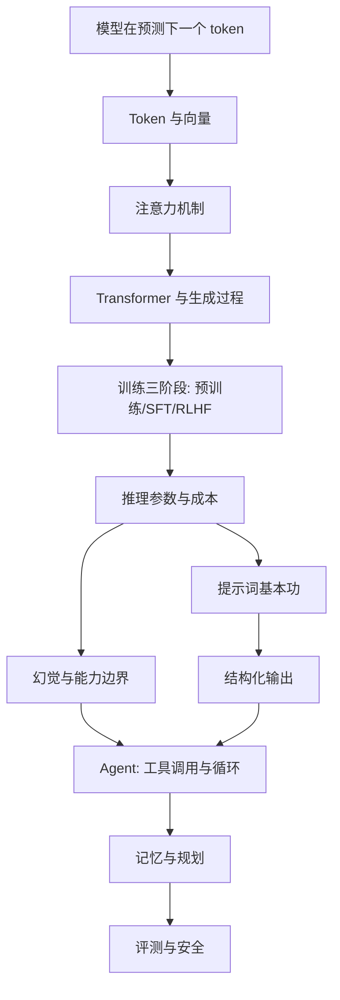

# 学习地图：先学什么，为什么

AI 的原理是**一层摞一层**的。跳过下层直接看上层，会背名词但不会判断。下面的箭头表示"没懂 A 就别碰 B"。

## 三层结构

| 层 | 内容 | 学完你能做什么 | 花多久 |
|---|---|---|---|
| 直觉层 | 预测下一个 token、概率、采样 | 解释模型的"自信"从哪来，为什么不稳定 | 第 1 周 |
| 机制层 | Token、向量、注意力、Transformer | 解释上下文长度、成本、长文为什么变笨 | 第 2 周 |
| 工程层 | 训练、参数、幻觉、Agent、评测 | 自己搭能用的系统，知道哪里会翻车 | 第 3–8 周 |

## 三个"必须先打通"的卡点

1. **概率取代事实**：模型输出的是"最像话的续写"，不是"查过的答案"。想通这一点，幻觉就不神秘了。
2. **上下文是唯一的工作记忆**：没写进上下文的，模型一律不知道；写进去的，它会当真。
3. **提示词是接口设计，不是咒语**：它决定模型看到什么、被约束成什么形状。

## 怎么判断自己学懂了

不看笔记，试着给一个不搞技术的朋友讲 3 分钟。讲的时候你卡住的那个词，就是你下一个要补的洞。
